<div align="center">

# Talent Match

### Analyseur intelligent de CV et d'offre d'emploi, avec bilan critique généré par IA

On donne un **CV** et une **offre d'emploi**. L'application montre **ce qui correspond, ce qui manque, et pourquoi**,
puis rédige un **bilan critique** comme le ferait un recruteur technique exigeant.


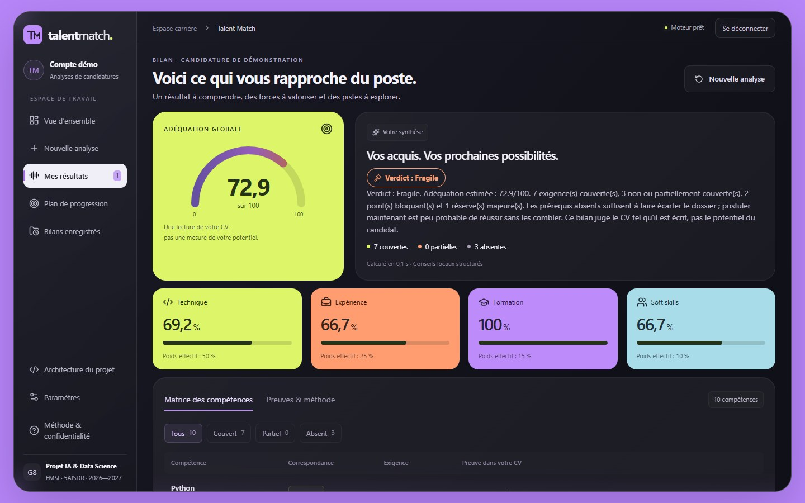

**Démo en ligne :** *lien Vercel ajouté après le déploiement*
**Compte de démonstration :** `demo@talentmatch.test` · mot de passe `TalentMatch-Demo-2026`

Projet du module **IA générative textuelle**, EMSI, 5AISDR G8, 2026–2027.
DRISSI Yassir · BENHEDDANE Mohamed · BAQLOUL Zineb. Encadrante : Mme Salma Aitoussous.

</div>

---

## Sommaire

1. [Le problème](#1-le-problème)
2. [La solution en une image](#2-la-solution-en-une-image)
3. [Visite guidée du dashboard](#3-visite-guidée-du-dashboard)
4. [Où est l'IA ? Le regard de l'ingénieur](#4-où-est-lia--le-regard-de-lingénieur)
5. [Ce qu'on a construit](#5-ce-quon-a-construit)
6. [Lancer en local](#6-lancer-en-local)
7. [Déployer sur Vercel](#7-déployer-sur-vercel)
8. [Structure du code](#8-structure-du-code)
9. [Tests et limites](#9-tests-et-limites)

---

## 1. Le problème

Un candidat envoie le même CV à 50 offres et ne sait pas pourquoi il n'est pas retenu.
Un recruteur, lui, parcourt un CV en quelques secondes et se pose trois questions :

| Question du recruteur | Ce que Talent Match vérifie |
|---|---|
| Les **prérequis** de l'offre sont-ils **prouvés** dans le CV ? | Chaque compétence demandée est cherchée dans le CV, avec la phrase qui le prouve |
| L'**expérience** et le **diplôme** sont-ils au niveau ? | Années d'expérience et niveau d'études extraits et comparés |
| Le CV parle-t-il **la langue de l'offre** ? | Les termes exacts de l'offre (ceux que filtrent les ATS) sont recherchés dans le CV |

Talent Match automatise cette lecture et la rend **explicable** : chaque point du score renvoie à une preuve.

## 2. La solution en une image

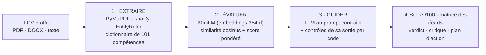

Le navigateur (React) n'effectue aucun calcul : il envoie les documents à l'API **FastAPI**, qui exécute le
pipeline NLP et renvoie un JSON typé (Pydantic). Les bilans que l'utilisateur choisit d'enregistrer vont dans
**SQLite**.

---

## 3. Visite guidée du dashboard

Chaque écran ci-dessous vient de l'application réelle, avec le compte de démonstration.
Pour chacun : **ce que voit l'utilisateur**, puis **ce qui se passe sous le capot**.

### 3.1 Connexion

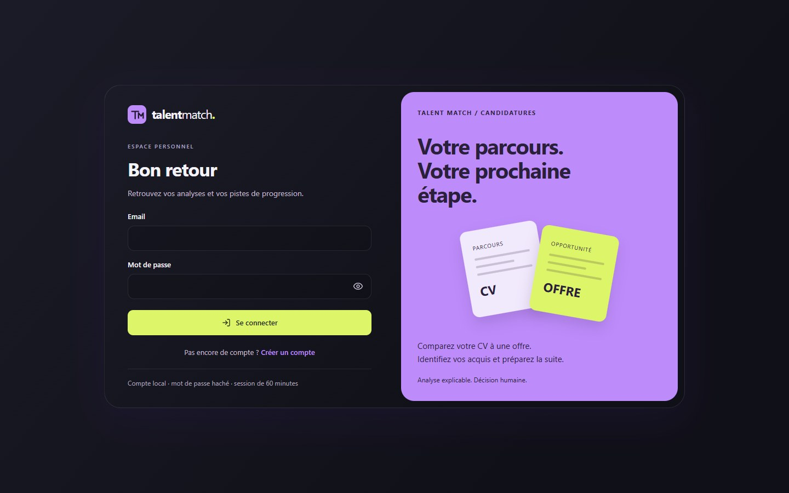

**À l'écran :** un espace personnel ; chaque utilisateur ne voit que ses propres bilans.
**Sous le capot :** mot de passe haché avec **bcrypt** (jamais stocké en clair), puis un **jeton JWT** signé,
valable 60 minutes, envoyé à chaque requête. Côté serveur, chaque requête SQL filtre par `utilisateur_id`.

### 3.2 Accueil

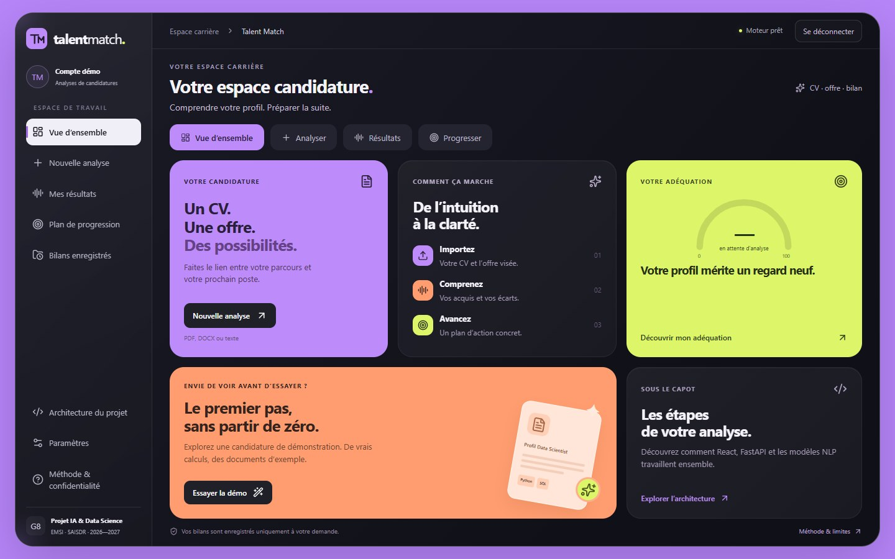

**À l'écran :** le parcours en trois temps (Importer → Comprendre → Avancer) et un bouton **Essayer la démo**
qui charge un CV et une offre d'exemple.
**Sous le capot :** l'indicateur « Moteur prêt » interroge `GET /health`. Le serveur ne se déclare prêt qu'après
avoir chargé spaCy et le modèle d'embeddings, pour que la première analyse ne télécharge rien.

### 3.3 Saisie du CV et de l'offre

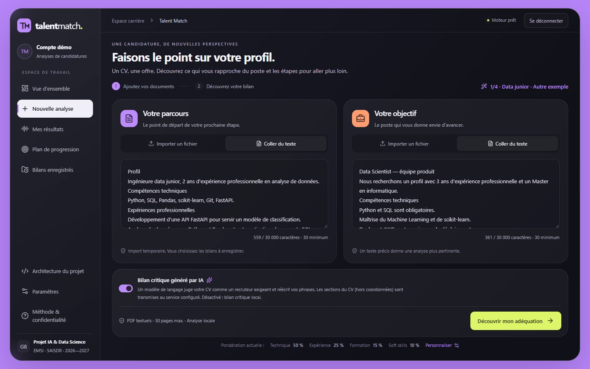

**À l'écran :** deux zones (« Votre parcours », « Votre objectif »), en fichier PDF/DOCX ou en texte collé.
L'option **Bilan critique généré par IA** est activée par défaut. Les pondérations du score sont rappelées en bas.
**Sous le capot :**
- **PyMuPDF** lit le PDF avec un tri spatial du texte et retire les en-têtes et pieds de page répétés ;
  **python-docx** lit les paragraphes et les tableaux.
- Garde-fous : 5 Mo, 30 pages et 30 000 caractères maximum ; les PDF protégés et les « bombes » ZIP
  sont refusés.
- Le texte est normalisé (Unicode NFKC, coupures de mots) puis **découpé en sections** (Expérience, Formation,
  Compétences, Projets) par des expressions régulières sur les titres.

### 3.4 Résultat : score et verdict


**À l'écran :** une jauge d'**adéquation globale** (72,9/100), le **verdict** (« Fragile ») et quatre
sous-scores : Technique, Expérience, Formation, Savoir-être.
**Sous le capot :**

```text
score = 0.50 × technique + 0.25 × expérience + 0.15 × formation + 0.10 × savoir-être
```

- Les poids sont réglables dans les **Paramètres** ; si l'offre ne précise pas un critère, son poids est
  redistribué sur les autres.
- Le **verdict est volontairement plus sévère que le score**. Ici le score est de 72,9, mais Docker et AWS,
  exigés, sont absents du CV. Or un recruteur ou un filtre ATS écarte un dossier sur un seul prérequis manquant,
  d'où « Fragile ». C'est le cœur du projet : **un chiffre rassurant ne doit pas masquer un manque bloquant**.

### 3.5 Matrice des compétences

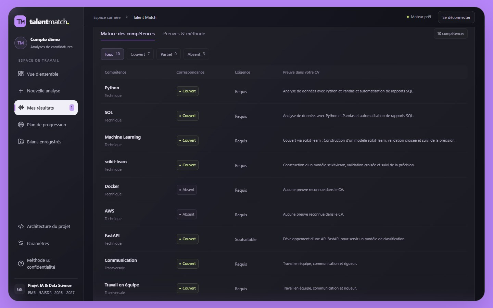

**À l'écran :** chaque exigence de l'offre, son statut (**Couvert / Partiel / Absent**), si elle est requise ou
souhaitable, et **la phrase du CV qui le prouve**.
**Sous le capot :** c'est le cœur NLP.
1. **Extraction (spaCy `EntityRuler`)** : un dictionnaire bilingue de 85 compétences techniques et 16 savoir-être,
   avec leurs synonymes (« apprentissage supervisé », « machine learning », « ML »…), repère les compétences dans
   les deux textes. Le moteur ignore les négations (« sans expérience en Docker ») et détecte les exigences
   facultatives (« FastAPI est un **atout** »), phrase par phrase.
2. **Couverture outil → concept** : le CV cite *scikit-learn* et l'offre demande du *Machine Learning*.
   L'outil prouve le concept, d'où **« Couvert via scikit-learn »**.
3. **Similarité sémantique** : quand rien ne correspond exactement, le modèle **all-MiniLM-L6-v2** transforme
   l'exigence et les phrases du CV en vecteurs de 384 dimensions. Une similarité cosinus ≥ 0,60 dans le même
   domaine donne au mieux **Partiel**. *Une ressemblance de sens ne prouve jamais une maîtrise.*

### 3.6 Preuves et méthode

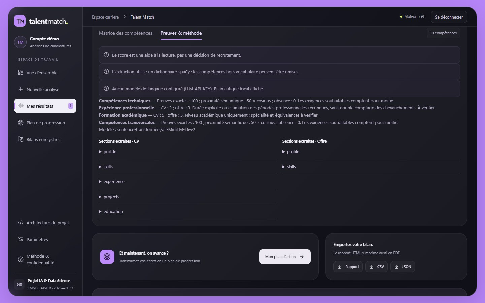

**À l'écran :** le détail du calcul de chaque critère, les sections reconnues dans le CV et l'offre, le modèle
utilisé et les avertissements (par exemple : aucun LLM configuré).
**Sous le capot :** la **transparence** est une exigence de conception. L'application montre ses propres limites
(« l'extraction utilise un dictionnaire : les compétences hors vocabulaire peuvent être omises ») au lieu de
les cacher.

### 3.7 Le regard du recruteur : la partie IA générative

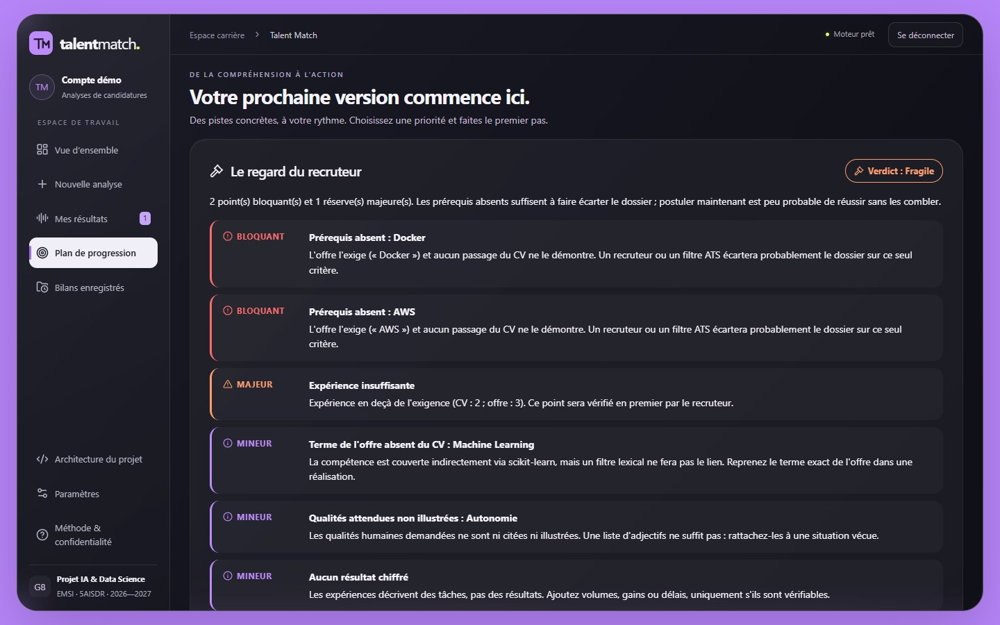

**À l'écran :** un bilan critique hiérarchisé par gravité : **BLOQUANT** (prérequis absent), **MAJEUR**
(expérience insuffisante), **MINEUR** (terme de l'offre absent du CV, qualités non illustrées,
aucun résultat chiffré).
**Sous le capot :** c'est l'objectif « IA générative textuelle » du projet, détaillé en [section 4](#4-où-est-lia--le-regard-de-lingénieur).
Les règles produisent d'abord un bilan de référence, que le LLM (Llama 3.3 70B) peut ensuite **réécrire** sous
contrôle.

### 3.8 Plan de progression

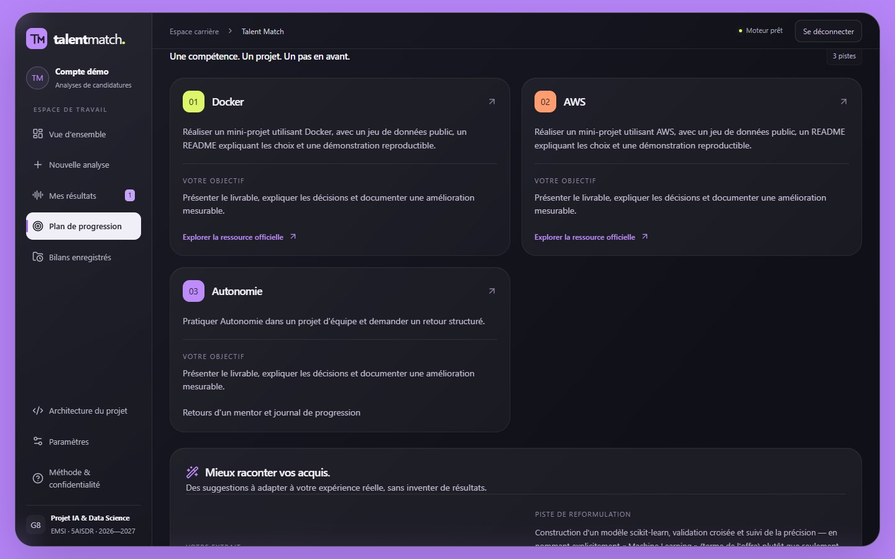

**À l'écran :** une carte par compétence manquante, avec un mini-projet concret, un **objectif mesurable** et un
lien vers la **ressource officielle** (documentation Docker, AWS…).
**Sous le capot :** les actions ne portent **que** sur les compétences non couvertes, et les liens viennent du
dictionnaire, **jamais du LLM**, ce qui écarte les URL inventées.

### 3.9 Reformulations du CV

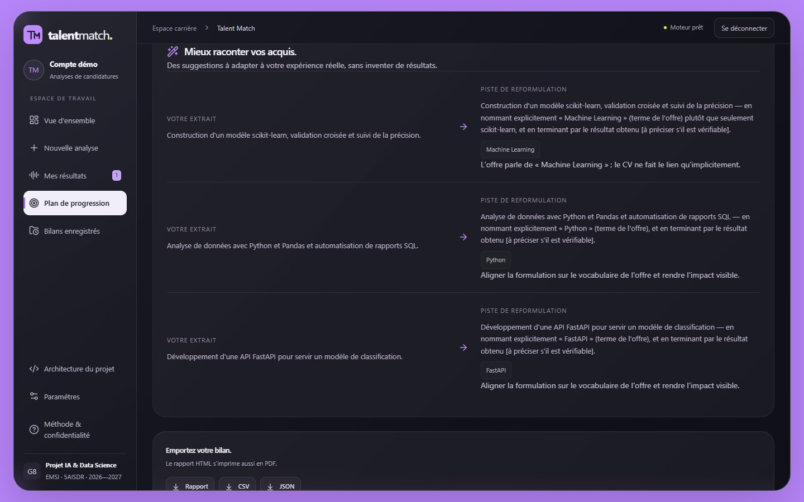

**À l'écran :** à gauche **une phrase réelle du CV**, à droite une proposition qui reprend **le vocabulaire de
l'offre**, avec le mot-clé visé et la justification. En bas, les exports : **rapport HTML/PDF, CSV, JSON**.
**Sous le capot :** une reformulation est **rejetée par le code** si la phrase « originale » n'existe pas mot pour
mot dans le CV, ou si la proposition **invente un chiffre**. Quand un résultat manque, l'outil écrit
`[à préciser s'il est vérifiable]` au lieu de l'inventer.

### 3.10 Bilans enregistrés

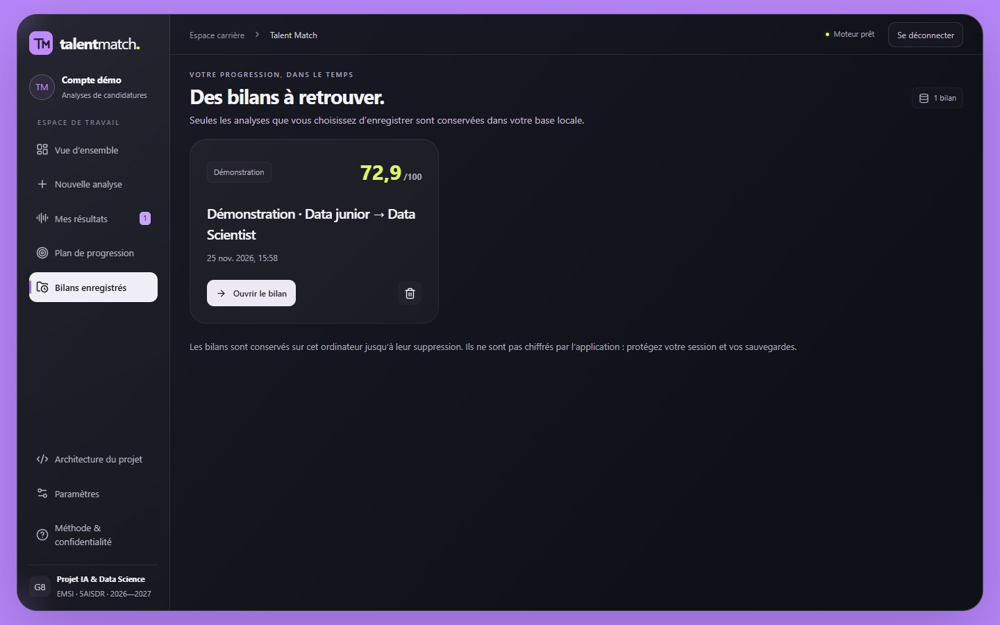

**À l'écran :** les analyses que l'utilisateur a **choisi** d'enregistrer, à rouvrir ou supprimer.
**Sous le capot :** table SQLite `analyses` (id UUID, titre, date UTC, score, résultat JSON), indexée par
propriétaire et date. Rien n'est enregistré sans action explicite ; les fichiers originaux ne sont jamais conservés.

### 3.11 L'architecture expliquée dans l'application

| Système | Pipeline NLP | Données & API |
|---|---|---|
| 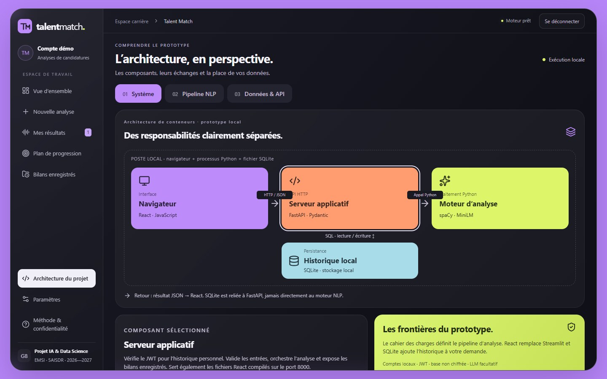 | 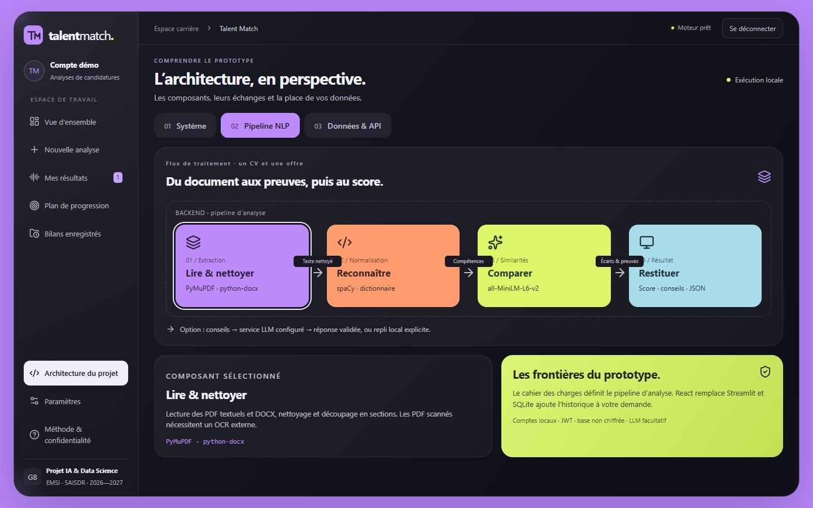 | 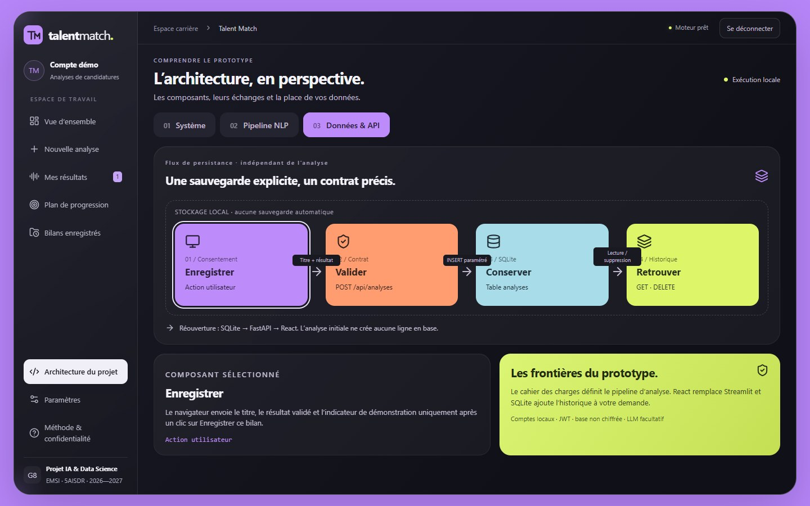 |

Trois vues interactives, intégrées au produit, pour un jury ou un nouveau développeur :
- **Système** : navigateur → FastAPI → moteur d'analyse → SQLite.
- **Pipeline NLP** : Lire & nettoyer → Reconnaître → Comparer → Restituer.
- **Données & API** : le cycle de vie d'un bilan enregistré.

### 3.12 Méthode, paramètres et mobile

| Méthode & confidentialité | Paramètres | Mobile |
|---|---|---|
| 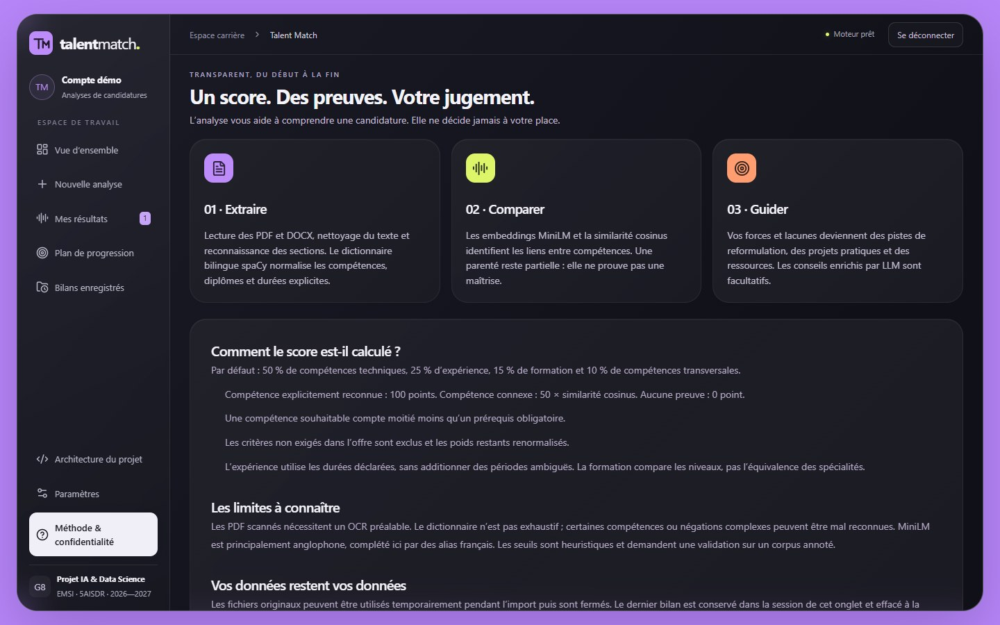 | 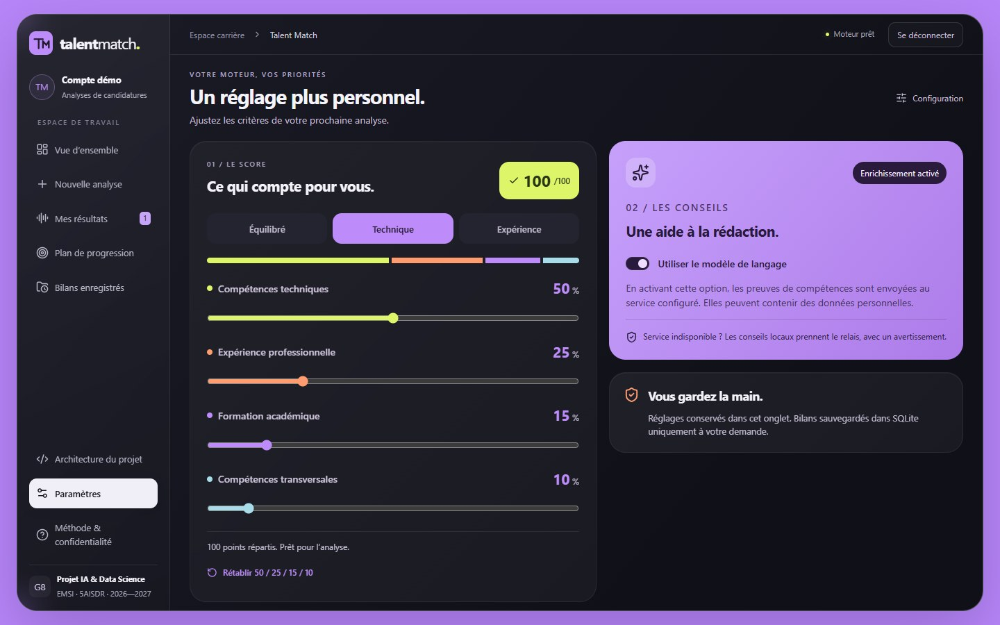 | 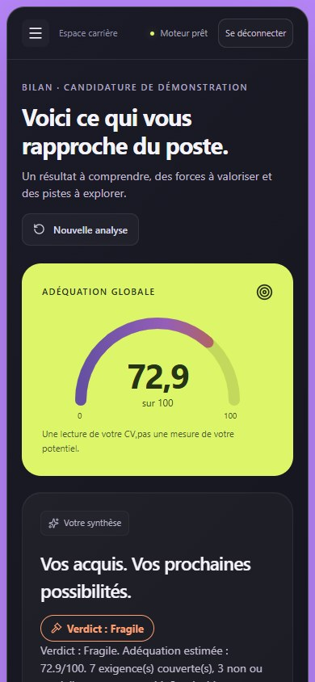 |

- **Méthode** : comment le score est calculé, les limites connues, et ce que deviennent les données.
- **Paramètres** : pondérations prédéfinies (Équilibré, Technique, Expérience) ou personnalisées, activation
  du LLM.
- **Mobile** : l'interface est responsive.

---

## 4. Où est l'IA ? Le regard de l'ingénieur

### Ce qu'on a fait, et ce qu'on n'a pas fait

**Aucun modèle n'a été entraîné.** Talent Match est un **pipeline NLP appliqué** : il assemble des modèles
pré-entraînés, des règles explicites et du *prompt engineering* sous contrôle.

| Brique | Rôle | Type | Entraînée par nous ? |
|---|---|---|---|
| spaCy `EntityRuler` | Repérer les compétences | Symbolique (dictionnaire) | Non |
| all-MiniLM-L6-v2 | Mesurer la proximité de sens | Transformer pré-entraîné (embeddings) | Non, utilisé tel quel |
| Score composite | Agréger en une note sur 100 | Formule pondérée explicite | Non |
| Llama 3.3 70B (Groq) | Rédiger le bilan critique | LLM génératif, piloté par prompt | Non |

**Pourquoi ce choix ?** Il n'existe pas de jeu de données annoté « CV × offre → adéquation ». Sans données
étiquetées, un modèle entraîné ne pourrait pas être évalué honnêtement. Une approche **explicable** permet de
justifier chaque point du score devant un candidat, un recruteur ou un jury.

### Génération contrôlée : « faire confiance, mais vérifier »

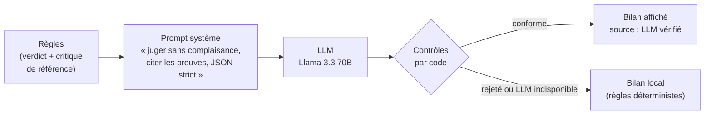

Le LLM reçoit les écarts calculés, les scores, le CV **sans l'en-tête de coordonnées** (protection des données
personnelles) et l'offre. Sa réponse JSON est validée par un schéma **Pydantic**, puis contrôlée :

| # | Contrôle | Risque évité |
|---|---|---|
| 1 | Le verdict du LLM ne peut **pas être plus favorable** que celui des règles (il peut être plus sévère) | Complaisance |
| 2 | La phrase « originale » d'une reformulation doit exister **mot pour mot** dans le CV | Citation inventée |
| 3 | Une reformulation ne peut pas introduire un **chiffre absent** de l'original | Résultats fabriqués |
| 4 | Un prérequis **bloquant** détecté par les règles ne peut pas disparaître | Omission d'un manque |
| 5 | Actions limitées aux compétences non couvertes ; liens issus du dictionnaire | URL et conseils hallucinés |

Si aucune clé n'est configurée, ou si le LLM échoue, l'application affiche le **bilan critique local** (mêmes
règles, formulation déterministe), avec un avertissement visible. Elle reste donc toujours utilisable.

### Choix d'ingénierie notables

- **MiniLM en ONNX Runtime au lieu de PyTorch** : mêmes poids officiels, mêmes vecteurs (écart mesuré de
  1 × 10⁻⁷), mais environ 450 Mo de dépendances au lieu de plusieurs Go. C'est ce qui permet le même code en
  local et sur Vercel.
- **Fournisseur LLM interchangeable** : toute API compatible OpenAI (Groq, OpenRouter, Mistral) ou **Ollama**
  en local, sans clé et sans que rien ne quitte la machine.
- **Contrats typés de bout en bout** : Pydantic côté serveur et JSON documenté sur `/docs` (OpenAPI).

---

## 5. Ce qu'on a construit

- **Backend FastAPI** : `POST /api/analyze` (JSON), `POST /api/analyze/files` (PDF/DOCX), comptes, historique,
  documentation interactive sur `/docs`.
- **Pipeline NLP** : lecture, nettoyage, segmentation, extraction par dictionnaire, négations, exigences
  facultatives, années d'expérience, niveau d'études, couverture outil → concept, similarité sémantique.
- **Score explicable** et **verdict de recruteur** plus strict que le score.
- **Génération contrôlée** : critique hiérarchisée, reformulations vérifiées, plan de progression.
- **Interface React 19** : 9 écrans, jauge animée, matrice filtrable, architecture interactive, exports
  HTML/CSV/JSON, responsive.
- **Sécurité** : bcrypt, JWT, isolation des données par utilisateur, limites de taille, aucune conservation
  des fichiers.
- **Client Streamlit** (exigence BNF1 du cahier des charges) qui consomme la même API.
- **Déploiement** : configuration Vercel et compte de démonstration créé automatiquement.

---

## 6. Lancer en local

**Prérequis :** [uv](https://docs.astral.sh/uv/getting-started/installation/) (installe Python 3.12),
[Node.js 22.12+](https://nodejs.org/), Internet au premier lancement (modèle MiniLM d'environ 90 Mo).

```bash
git clone https://github.com/BAQLOULZINEB/congenial-memory.git talentmatch
cd talentmatch
uv sync
uv run python run.py
```

`run.py` installe les dépendances React, compile l'interface, démarre FastAPI et ouvre
**http://127.0.0.1:8000**. Connectez-vous avec le compte de démonstration ou créez un compte.

| Commande | Usage |
|---|---|
| `uv run python run.py --skip-build` | Relancer sans recompiler React |
| `cd frontend-react && npm run dev` | Développement React à chaud (port 5173, backend démarré) |
| `uv run --group ui streamlit run frontend/streamlit_app.py` | Client Streamlit (port 8501) |

**Activer le bilan généré par IA (gratuit) :** créez une clé sur
[console.groq.com/keys](https://console.groq.com/keys), copiez `.env.example` en `.env`, renseignez
`LLM_API_KEY=...`, puis relancez.

---

## 7. Déployer sur Vercel

Le **même code** tourne en ligne :

- l'interface React compilée est servie par le CDN de Vercel ;
- l'API FastAPI tourne comme fonction Python (`api/index.py`), routée par `vercel.json`.

1. Sur [vercel.com/new](https://vercel.com/new), importez ce dépôt et nommez le projet `talentmatch`.
   Laissez **Framework Preset : Other**.
2. Dans **Environment Variables**, ajoutez :

   | Variable | Valeur | Obligatoire |
   |---|---|---|
   | `JWT_SECRET` | 32+ caractères aléatoires : `python -c "import secrets;print(secrets.token_urlsafe(48))"` | Oui |
   | `LLM_API_KEY` | Clé Groq | Non (sinon bilan local) |

3. Cliquez sur **Deploy**. Le premier appel prend 10 à 30 s (démarrage à froid et téléchargement du modèle).

**Base de données en ligne, en mode démonstration :** sur Vercel, seul `/tmp` est accessible en écriture. SQLite
y est créée au démarrage avec le compte de démonstration et un bilan d'exemple. Inscription, connexion et
sauvegarde fonctionnent, mais la base est **réinitialisée** quand Vercel recycle l'instance. C'est voulu pour une
démo pédagogique, sans données personnelles durables. Pour une persistance réelle, il suffit de brancher une base
hébergée (Turso, Neon…) dans `backend/storage.py`.

---

## 8. Structure du code

```text
api/index.py                Point d'entrée Vercel (importe l'app FastAPI)
backend/
  main.py                   Routes, démarrage, compte de démonstration
  parsing.py                Lecture PDF/DOCX, nettoyage, garde-fous
  extraction.py             spaCy EntityRuler, sections, diplômes, négations
  experience.py             Années d'expérience
  taxonomy.py               Dictionnaire : compétences, synonymes, outil → concept, ressources
  embeddings.py             MiniLM en ONNX Runtime
  analysis.py               Matrice des écarts et score composite
  recommendations.py        Verdict, critique, prompt LLM et contrôles de sa sortie
  auth.py, auth_routes.py   bcrypt + JWT
  storage.py                SQLite
  schemas.py                Contrats Pydantic
frontend-react/src/         Interface React 19 (Vite)
frontend/streamlit_app.py   Client Streamlit
tests/                      Tests pytest
docs/                       Architecture, exigences, validation, captures d'écran
vercel.json                 Build et routage Vercel
```

---

## 9. Tests et limites

```bash
uv run pytest -q             # 59 tests : pipeline, API, authentification, critique, déploiement
uv run ruff check .
cd frontend-react && npm test && npm run build   # 21 tests React
```

Les tests utilisent des embeddings factices et n'appellent jamais un vrai LLM : ils sont rapides et reproductibles.

**Limites assumées :**
- Une compétence absente du dictionnaire (101 entrées) n'est pas détectée.
- MiniLM est surtout anglophone ; les synonymes bilingues compensent en partie pour le français.
- Les seuils (0,60, poids par défaut) sont des choix raisonnés, non calibrés sur un corpus annoté.
- Les PDF scannés nécessitent un OCR préalable.
- Le bilan LLM doit être relu : il ne doit jamais servir à inventer des acquis.

---

<div align="center">

[FastAPI](https://fastapi.tiangolo.com/) · [spaCy](https://spacy.io/api/entityruler) ·
[all-MiniLM-L6-v2](https://huggingface.co/sentence-transformers/all-MiniLM-L6-v2) ·
[ONNX Runtime](https://onnxruntime.ai/) · [React](https://react.dev/) · [Groq](https://console.groq.com/) ·
[Guide d'architecture](docs/architecture.md)

</div>
