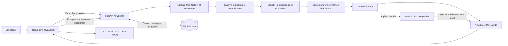

# Architecture de Talent Match

Talent Match sépare l'interface qui présente la candidature du moteur Python qui l'analyse.
React gère les documents, les réglages et la lecture des résultats ; FastAPI reçoit les données,
exécute le pipeline NLP et retourne un résultat JSON validé. SQLite conserve uniquement les bilans
que l'utilisateur choisit d'enregistrer.

## Explication simple pour la présentation du prototype

1. **React affiche le site** : on ajoute un CV et une offre, puis on lit le résultat.
2. **FastAPI reçoit la demande** : il vérifie les documents et appelle les modules Python.
3. **Le moteur NLP analyse les textes** : spaCy repère les compétences ; MiniLM aide à comparer leur sens.
4. **Le moteur de score et de conseils prépare le bilan** : acquis, écarts, score et actions proposées.
5. **SQLite garde les bilans enregistrés** : on peut les rouvrir ou les supprimer après un redémarrage.

Le cahier des charges prévoyait Streamlit et ne demandait pas explicitement de base de données.
React et l'historique SQLite sont deux évolutions demandées ensuite. Le pipeline métier reste celui du cahier.

## Vue d'ensemble



Le modèle d'embeddings **all-MiniLM-L6-v2** mesure une proximité entre des textes. Il ne rédige pas les conseils.
La génération libre de recommandations relève du **LLM optionnel**, distinct du modèle d'embeddings.
Sans ce service, les conseils restent disponibles sous forme de textes structurés construits localement.

## Les couches et leurs responsabilités

| Couche | Technologie et rôle | Fichiers principaux |
|---|---|---|
| Interface | React 19 et JavaScript : formulaires, navigation, score, preuves et progression | `frontend-react/src/App.jsx`, `main.jsx` |
| Présentation | CSS et Tailwind : panneaux vitrés sombres, cartes colorées, adaptation aux tailles d'écran | `frontend-react/src/styles.css`, `vite.config.js` |
| Navigation et mouvement | React Router, Framer Motion et Lucide : pages, transitions et icônes | `frontend-react/src/App.jsx` |
| Client HTTP | Validation de saisie et construction de la requête multipart avec `fetch` | `frontend-react/src/api.js` |
| API | FastAPI : routes, traitement des fichiers, gestion des erreurs et distribution du build React | `backend/main.py` |
| Contrats | Pydantic : types, longueurs des textes, poids et structure du résultat | `backend/schemas.py` |
| Lecture | PyMuPDF et python-docx : extraction PDF/DOCX, contrôles et nettoyage Unicode | `backend/parsing.py` |
| Extraction | spaCy EntityRuler : compétences du dictionnaire, sections, diplômes et durées explicites | `backend/extraction.py`, `taxonomy.py` |
| Sémantique | Sentence-Transformers et Hugging Face : chargement de MiniLM, vecteurs normalisés | `backend/embeddings.py` |
| Évaluation | Comparaison des preuves, critères, pondération et avertissements | `backend/analysis.py` |
| Conseils | Conseils déterministes et appel facultatif à un service compatible Chat Completions | `backend/recommendations.py` |
| Exports | Production locale de HTML imprimable, CSV et JSON dans le navigateur | `frontend-react/src/exports.js` |
| Historique | Enregistrement explicite et réouverture des bilans, suppression et pagination | `frontend-react/src/SavedAnalyses.jsx` |
| Persistance | SQLite : requêtes paramétrées, transactions, un fichier local | `backend/storage.py`, `data/talentmatch.sqlite3` |
| Démarrage | Installation et compilation npm, démarrage du backend, attente du modèle | `run.py`, `start.ps1` |

`frontend/reports.py` conserve les exporteurs Python historiques pour les usages programmatiques et leurs tests.
La nouvelle interface React utilise ses propres exporteurs JavaScript et ne dépend pas de Streamlit.

## Parcours d'une analyse

```mermaid
sequenceDiagram
    participant U as Utilisateur
    participant R as Interface React
    participant A as FastAPI
    participant N as Pipeline NLP
    participant L as LLM optionnel
    participant DB as SQLite
    U->>R: Choisit un CV, une offre et les poids
    R->>R: Vérifie formats, tailles et total de 100 %
    R->>A: POST /api/analyze/files (multipart)
    A->>A: Lit les fichiers et valide AnalysisRequest
    A->>N: Textes nettoyés + poids
    N->>N: Extrait, normalise, vectorise et évalue
    N->>N: Produit les conseils locaux
    opt Enrichissement explicitement activé
        N->>L: Compétences, preuves et brouillon
        L-->>N: Recommandations JSON
        N->>N: Valide ; sinon conserve les conseils locaux
    end
    N-->>A: AnalysisResult
    A-->>R: JSON : score, écarts, preuves, conseils, durées
    R-->>U: Affiche résultats et téléchargements
    opt Enregistrement demandé par l'utilisateur
        U->>R: Enregistrer ce bilan
        R->>A: POST /api/analyses
        A->>DB: Sauve le bilan validé
        DB-->>R: Identifiant du bilan (via API)
    end
```

Pour chaque document, l'utilisateur fournit **un fichier ou du texte**, pas les deux.
Le client représente les pondérations en pourcentages ; il les convertit en fractions avant l'envoi.
Le serveur les valide à nouveau : les validations du navigateur facilitent la saisie, mais ne remplacent
jamais les contrôles Python.

L'API propose aussi `POST /api/analyze` pour les clients qui envoient directement un JSON de textes.
`GET /health` indique la disponibilité du moteur, et `/docs` fournit la documentation interactive de l'API.

## Base de données du prototype

SQLite est intégrée à Python : aucun serveur de base distant n’est nécessaire. Les comptes de l’application sont stockés dans utilisateurs.
Le fichier `data/talentmatch.sqlite3` est créé au démarrage, avec une table `analyses` :
`id`, `title`, `created_at`, `score`, `is_demo` et `payload` (résultat JSON complet).
Les colonnes de résumé alimentent l'historique ; le JSON permet de rouvrir les preuves, le plan et les exports.
Les requêtes SQL utilisent des paramètres et des transactions. Les fichiers de base sont exclus de Git.

| Action | Route |
|---|---|
| Enregistrer un résultat validé | `POST /api/analyses` |
| Lister les bilans (pagination) | `GET /api/analyses?limit=12&offset=0` |
| Rouvrir un bilan complet | `GET /api/analyses/{id}` |
| Supprimer un bilan | `DELETE /api/analyses/{id}` |

`DATABASE_PATH` permet de choisir l'emplacement. Un chemin relatif est résolu depuis la racine du projet.
Les bilans enregistrés survivent au redémarrage du serveur et du navigateur. Les PDF/DOCX originaux
ne sont pas stockés dans la table, mais le JSON contient des extraits personnels : l'enregistrement est explicite.
La base n'est pas chiffrée par l'application. Pour une mise en ligne, il faudra renforcer la protection des sessions,
séparation des utilisateurs, sauvegardes et règles de conservation avant toute exposition publique.

## Comment le résultat est construit

L'extraction associe les variantes connues à un nom canonique : par exemple `sklearn` devient `scikit-learn`.
Les extraits de texte qui justifient les compétences accompagnent le résultat pour permettre une relecture.
Il s'agit d'une reconnaissance d'entités **par règles et dictionnaire**, pas d'un NER entraîné sur un corpus de CV.

Le moteur encode les descriptions de compétences avec MiniLM et normalise les vecteurs. Leur produit scalaire
donne alors la similarité cosinus. Il distingue trois cas :

- **Couvert** : la compétence canonique figure explicitement dans le CV ; elle reçoit 100 points.
- **Partiel** : une relation du dictionnaire ou une proximité suffisante dans le même domaine fournit une piste,
  sans prouver la maîtrise. Le crédit vaut `50 × coefficient de similarité` ; une relation connue fixe ce coefficient
  à au moins 0,60.
- **Absent** : aucune preuve reconnue n'appuie la compétence ; elle reçoit zéro point.

La formule par défaut est `50 % technique + 25 % expérience + 15 % formation + 10 % transversal`.
L'expérience repose sur les années déclarées explicitement ; la formation compare les niveaux reconnus.
Quand l'offre ne précise pas un critère, ce critère est exclu et les autres poids sont renormalisés.
Quand une exigence est reconnue dans l'offre mais n'a pas de preuve dans le CV, le critère vaut zéro.

Le résultat contient les poids demandés et effectifs, les sous-scores, la matrice des écarts, les sections extraites,
les recommandations, la source des conseils et les durées. Le score décrit l'adéquation documentaire ;
il n'est ni une probabilité d'embauche ni une décision de recrutement.

## Exécution en production locale et en développement

**Application compilée :** `uv run python run.py` exécute `npm ci` puis `npm run build`, démarre FastAPI
et ouvre `http://127.0.0.1:8000` lorsque le modèle est prêt. FastAPI sert à la fois les fichiers
de `frontend-react/dist` et les routes API. Le navigateur appelle donc `/api/...` sur la même origine.
`--skip-build` réutilise une compilation existante ; `--no-browser` évite l'ouverture automatique.

**Développement :** Vite sert React sur `http://127.0.0.1:5173` et relaie les requêtes `/api` et `/health`
au backend sur le port 8000. Vite apporte le rechargement rapide de l'interface ; le calcul NLP reste en Python.

Les routes API précèdent le mécanisme de repli React. Une route React profonde comme `/resultats` reçoit
le fichier `index.html`, tandis qu'une route `/api` inconnue reçoit une erreur JSON 404.
Les assets Vite portant une empreinte sont mis en cache longtemps ; le HTML est revalidé afin de charger
les références de la dernière compilation.

## Données et confidentialité

Les fichiers originaux ne sont pas conservés durablement par l'application.
Les résultats non enregistrés résident dans l'état de l'onglet et disparaissent lors d'un rechargement.
Les bilans enregistrés volontairement restent dans SQLite jusqu'à leur suppression et comprennent des extraits du CV.
FastAPI peut utiliser des fichiers temporaires sur disque pour les téléversements volumineux ;
ces fichiers sont fermés après le traitement de la requête.

Le cache Hugging Face conserve les **poids du modèle**, pas les CV ou leurs embeddings.
Les exports HTML, CSV et JSON sont créés dans le navigateur lorsque l'utilisateur les demande.
Le HTML échappe les contenus importés ; le CSV neutralise les préfixes susceptibles d'être interprétés comme des formules.
Le JSON contient les sections extraites et doit être traité comme un document personnel.

L'enrichissement LLM est désactivé par défaut. Lorsqu'il est activé, le service configuré reçoit les compétences
et leurs extraits justificatifs, plutôt que le CV complet. Ces extraits peuvent néanmoins contenir des informations
personnelles. Un serveur distant reçoit donc ces données. Une erreur réseau ou une réponse non conforme déclenche
un repli visible vers les conseils locaux.

## Configuration et limites

`backend/config.py` lit les valeurs de `.env` : `EMBEDDING_MODEL`, `LLM_BASE_URL`, `LLM_MODEL`, `LLM_API_KEY` et `DATABASE_PATH`.
Les clés restent côté Python et ne sont pas intégrées au build JavaScript. Le modèle d'embeddings est chargé
une fois par processus, d'abord depuis le cache local. Ses appels d'encodage sont protégés par un verrou.

Les limites actuelles sont 5 Mo par fichier, 30 pages PDF et 30 000 caractères par texte.
Les PDF scannés nécessitent un OCR préalable. Les compétences absentes du dictionnaire, les formulations complexes
et les équivalences de diplômes nécessitent une vérification humaine. MiniLM est principalement anglophone ;
les alias bilingues aident le français sans constituer une validation statistique de précision.

La cible de cinq secondes porte sur le pipeline à chaud, hors chargement initial et génération LLM.
La validation du JSON généré contrôle sa structure et certaines références, pas la véracité de toutes ses phrases.
Les conseils doivent être relus. Cette version locale comprend des comptes ; elle ne comprend pas de récupération de mot de passe ni d’infrastructure de déploiement public.


## Authentification et diagrammes interactifs

La page Architecture propose trois vues : système (React ↔ FastAPI, moteur NLP, branche SQLite), pipeline NLP et données/API. Chaque composant peut être sélectionné au clavier ou à la souris pour afficher son rôle.

L’authentification réutilise le projet immobilier : bcrypt, JWT HS256 (60 minutes), utilisateurs en SQLite. La relation utilisateurs.id → analyses.utilisateur_id isole les bilans. Les routes d’historique vérifient le jeton et le propriétaire à chaque requête. Les comptes et la migration sont détaillés dans [auth-reuse.md](auth-reuse.md).
